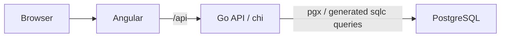

# Tessera

Every shift in its place.

A shift-planning app built with Go, Angular, and PostgreSQL. Browse a sample workspace without an account, then sign up when you're ready to bring your own team.

## What it does

- Create a team, verify your email, and invite teammates.
- Manage people, locations, and job qualifications.
- Build weekly rosters with checks for overlapping shifts, rest time, and weekly hours.
- Publish schedules for employees and track changes in the activity log.

Light and dark themes are included. Availability and leave are next on the [roadmap](docs/implementation-plan.md).

## Architecture

One repo, two apps: `frontend/` holds Angular and `backend/` holds Go. The API contract lives in `contracts/`, with generated clients keeping both sides in sync.

## Running locally

You'll need Go 1.25.1+, Node 22, npm 11.6.2, and PostgreSQL 17+.

The [development guide](docs/development.md) covers setup, demo accounts, and tests.

## Deployment

The frontend and backend deploy as separate Vercel projects, with PostgreSQL hosted separately. Resend handles verification and invitation emails.

See the [deployment guide](deploy/README.md) and [signup and email setup](docs/production-onboarding.md).
